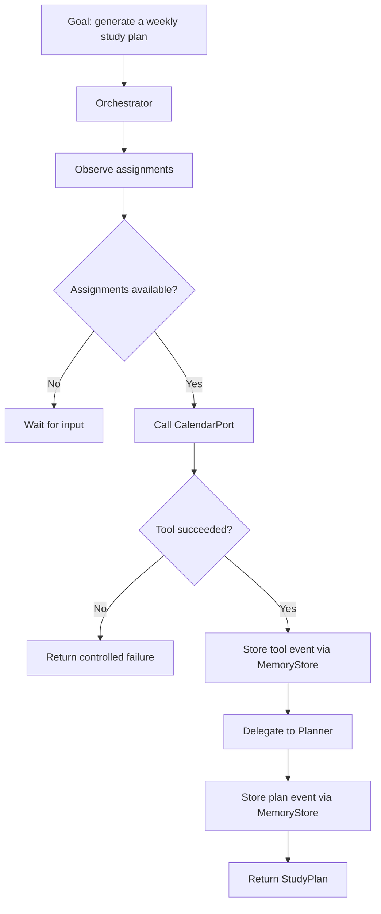

# Agent Architecture 

 

 

## Agent responsibilities 

 

- **Orchestrator:** controls the workflow and decides what component is called next. 

- **Planner:** contains deterministic planning logic. 

- **Tool port:** defines what calendar capability the workflow needs. 

- **Memory port:** defines how events are stored and retrieved. 

- **Adapters:** implement external details without becoming the application's core logic. 