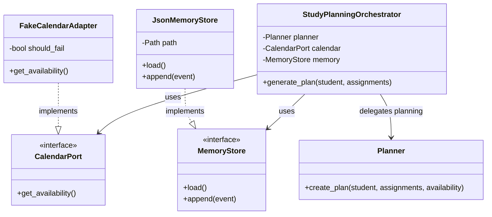

# Interfaces 

 

 

## Why these interfaces matter 

 

`CalendarPort` and `MemoryStore` protect the core workflow from provider-specific details. A later real calendar or SQLite memory adapter can replace the teaching adapters without rewriting the orchestrator. 