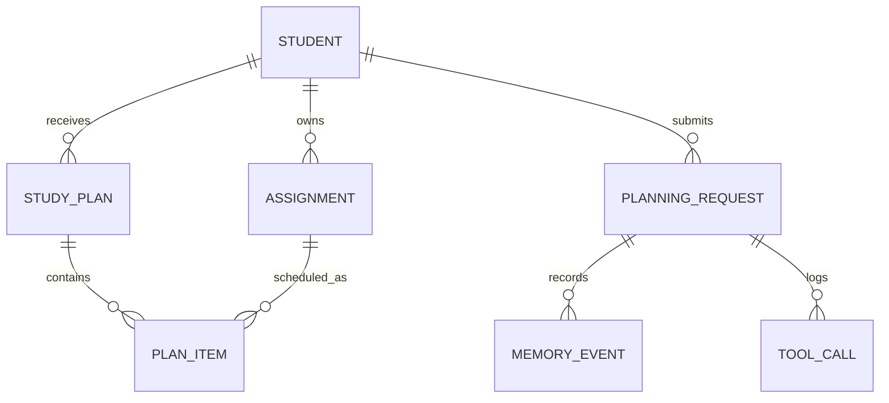

# Conceptual Data Model 

 

The conceptual model names the important information concepts and relationships before SQL types or implementation details are added. 

 

 

Teaching interpretation: 

- `PLAN_ITEM` is an association concept between a plan and an assignment. 

- `PLANNING_REQUEST` stores task state for one agent workflow. 

- `MEMORY_EVENT` stores persistent memory/history. 

- `TOOL_CALL` stores trace information about external actions. 